# 03 — Technical terms and the inference stack

Paths: `[1.7B]` = `direct_inference_1_7B/`, `[0.6B]` = `direct_inference_baseline/`.
Every technology below is marked **USED** (seen in code/config/logs, with the file), **NOT USED** (common but absent here), or **BACKGROUND** (explained because evaluators may ask).

---

## 1. What we actually used (verified list)

| Technology | Status | Evidence |
|---|---|---|
| OpenVINO runtime 2026.4.1 | **USED** | `[1.7B]/manifests/HARDWARE_ENV_PREFLIGHT.json`, `CONVERSION_RECORD_Qwen3-1.7B.json` |
| OpenVINO GenAI 2026.4.1.0 (`openvino_genai.LLMPipeline`) | **USED** | `[1.7B]/scripts/ov_client_1_7b.py` |
| openvino-tokenizers (tokenizer/detokenizer as OpenVINO models) | **USED** | `openvino_tokenizer.xml/.bin`, `openvino_detokenizer.xml/.bin` in `[1.7B]/models/Qwen3-1.7B-ov-fp16/` |
| optimum-intel 2.2.0 + optimum 2.3.0 (`optimum-cli export openvino`) | **USED for conversion** | conversion record `export_command` and `tools` |
| Hugging Face Hub (`huggingface_hub.snapshot_download`) | **USED to download weights** | `[1.7B]/scripts/download_model.py` (pinned revision) |
| Hugging Face Transformers 5.5.4 | **USED** — by the converter/tokenizer export; and in **0.6B EXP_001** as the CPU inference engine | conversion record; `[0.6B]/inference/huggingface_client.py` |
| NNCF 3.4.0 | installed (toolchain) but **no quantisation applied** (FP16 only) | conversion record `converted_precision` |
| psutil | **USED** for RAM sampling/gate | `ov_client_1_7b.py`, `run_prompt.py` |
| Python 3.12.3 in an isolated venv (`env_openvino`) | **USED** | `[0.6B]/experiments/EXP_002…/phase1_report.md` |
| PyTorch | used only inside conversion/EXP_001 (not in the OpenVINO inference path) | `huggingface_client.py` |
| Git LFS for model weights | **USED** for storage in the repo | commit `bfbc0ab` |
| INT8 / INT4 quantisation | **NOT USED** (planned options in EXP_002 feasibility plan; FP16 chosen) | conversion records |
| Constrained / grammar decoding | **NOT USED** (EXP_007 tested it as a plan; gate failed, B3 not run) | `EXP_007…/reports/PHASE_A_REPORT.md` |
| Sampling (temperature, top-p, top-k) | **NOT USED** (greedy) | `describe()` → "not applied (greedy)" |
| Foundry / hosted endpoint | implemented in code but **NOT USED** for Qwen | `[0.6B]/README.md` |
| System prompt vs user prompt | **single user message**; no separate system prompt | `ov_client_1_7b.py`: `apply_chat_template([{"role":"user",…}])` |
| RAG, LoRA, fine-tuning | **NOT USED** | README: "No fine-tuning, LoRA, RAG…" |

---

## 2. Glossary (plain language)

| Term | Meaning (and where it appears in our project) |
|---|---|
| **Qwen3** | The language-model family we use. |
| **Model weights** | The learned numbers (BF16 originally; FP16 after conversion). Files: `model-0000x-of-00002.safetensors` (Hugging Face) → `openvino_model.bin` (OpenVINO). |
| **Hugging Face (HF) / Hub** | A website/service hosting model files; we downloaded Qwen from it. |
| **Transformers** | HF's Python library for running/training transformer models; we used it for CPU run in EXP_001 and in the converter. |
| **Tokenizer** | Converts text ↔ token ids. Files: `tokenizer.json`, `vocab.json`, `merges.txt`. |
| **Model revision / hash** | The exact commit of the model repo (`70d244cc…`). Pinning it means a later upload cannot silently change our model. |
| **HF cache** | Local folder with downloaded files (`[1.7B]/models/hf_cache`). Offline inference = run with `HF_HUB_OFFLINE=1`, no internet. |
| **Model conversion** | Re-saving the model into another format. Here: HF safetensors (BF16) → OpenVINO IR (FP16). Does **not** train the model or intentionally change its behaviour. |
| **OpenVINO IR** | "Intermediate Representation": two files — `.xml` (the graph: layers and how they connect) and `.bin` (the weights). |
| **FP32 / FP16 / BF16 / INT8** | Number formats: 32-bit float (most precise, 4 bytes), 16-bit float (2 bytes), bfloat16 (16-bit with FP32's range, less precision), 8-bit integer (1 byte, needs quantisation). We converted BF16 → FP16. |
| **Quantisation** | Storing weights in fewer bits to save memory/time. Not used. |
| **CPU / GPU inference** | Run the maths on the processor or the graphics chip. |
| **Integrated GPU (iGPU)** | A GPU inside the CPU package that shares system RAM — ours is **Intel UHD Graphics 620**, 24 execution units. |
| **Device selection** | Telling OpenVINO where to run: `"GPU"`. Our client asserts `device == "GPU"`; no CPU fallback. |
| **Prompt engineering** | Improving the instructions without changing the model. P00→P02. |
| **Greedy decoding** | Always take the most probable next token. |
| **Temperature / top-p / top-k** | Randomness controls for sampling; irrelevant to greedy; not applied. |
| **max_new_tokens / token cap** | Maximum tokens the model may write (4,096 for 1.7B). Hitting it = "truncated" output. |
| **Context window** | Max tokens (prompt + output) attended to; 40,960 for these models. |
| **JSON output / structured extraction** | Asking for the answer as machine-readable JSON, filling a fixed schema. |
| **Schema validation** | Checking the JSON has the required keys, types and allowed values (`schema_validator.py`). |
| **Strict matching** | Facts count as equal only if their normalised key strings are identical. |
| **TP / FP / FN** | True positive (extracted and in gold), false positive (extracted, not in gold), false negative (in gold, not extracted). |
| **Precision / recall / F1** | See `supporting/metric_definitions.md`. |
| **Evidence IDs** | Segment ids (e.g. `SEG0007`) the model cites for a fact. |
| **Evidence backfill** | Backend code (`p02/code/backfill_evidence.py`) that turns the model's segment ids into full evidence records (`EV_001…`) and flags invalid ids. It does not alter the model's own output. |
| **RAM / virtual memory** | RAM = physical memory. Virtual memory = Windows pages RAM to disk when short; it keeps programs alive but is extremely slow. |
| **OOM** | Out-of-memory error. Our runner stops (`--stop-on-oom`, exit code 5) rather than retry. |
| **Experiment freeze / manifest** | A JSON listing the SHA-256 of the prompt, config and scripts before inference; if any changes, the runner stops (exit code 4). |
| **Reproducibility** | Same inputs + same frozen setup → same outputs. Ensured by pinned revision, frozen files, greedy decoding, fixed ids. |
| **KV cache** | Stored attention keys/values of already-processed tokens, so the model does not recompute them. Uses RAM, grows with length. |
| **Prefill / decode** | Prefill = reading the prompt (fast, parallel). Decode = generating tokens one at a time (slow). |

---

## 3. OpenVINO, explained so you can answer anything

1. **What is it?** Intel's open-source toolkit to optimise and run trained neural networks on Intel hardware (CPU, integrated GPU, NPU). **[General knowledge]**
2. **Why did we use it?** The CPU run through Transformers took ~634 s/record at ~1.5 tokens/s (EXP_001). OpenVINO on the iGPU gave ~5.7 tokens/s (~3.7× faster) for the same 5 records with identical entity scores (`EXP_003…/comparison_with_EXP_001_dev100.md`). The laptop has no dedicated GPU, so this was the way to use the graphics chip.
3. **What problem does it solve?** Frameworks like PyTorch are designed for training and NVIDIA GPUs; OpenVINO converts a model into a form tuned for Intel devices and runs it with Intel's kernels.
4. **How does it help on Intel hardware?** It compiles the graph for the chosen device (here the GPU), uses FP16 maths the iGPU supports, and caches the compiled result (`ov_cache` folders).
5. **Model conversion:** one-off export (`optimum-cli export openvino … --weight-format fp16`). 1.7B took 64.7 s (`conversion_wall_seconds`) and used up to 15.7 GB system memory at peak (min available 504 MB) — conversion itself needs a lot of RAM.
6. **OpenVINO IR:** the converted model format (below).
7. **XML and BIN:** `.xml` = the model's architecture (graph), small; `.bin` = the weights, large (3.44 GB for 1.7B). Analogy: the `.xml` is the recipe, the `.bin` is the ingredients.
8. **Device target:** the string `"GPU"`/`"CPU"` passed to `LLMPipeline(model_dir, "GPU")`.
9. **CPU vs GPU inference:** the CPU has few powerful cores; the GPU has many simple units suited to big matrix maths. Our CPU has 4 cores/8 threads; the UHD 620 has 24 EUs. On this laptop the GPU was ~3.7× faster for the 0.6B.
10. **Why integrated ≠ dedicated:** a dedicated GPU has its own fast memory (VRAM) and much higher throughput; an iGPU shares system RAM and bandwidth with the CPU. Result for us: speed is limited by memory bandwidth (decode ~2.7 tokens/s for 1.7B) and the GPU's memory appears as part of system RAM (device reports 6.79 GB total).
11. **Does OpenVINO train the model?** No. It only runs (and converts) models.
12. **Is OpenVINO an LLM?** No. It is the engine; Qwen is the model.
13. **Does conversion improve accuracy?** No. It aims to preserve behaviour (FP16 is a precision change; for 0.6B the entity metrics on 5 records were identical but 3 of 5 outputs differed slightly). Quality is a property of model + prompt.
14. **Why does inference use so much RAM?** Weights (3.4 GB) + KV cache + GPU buffers + compile caches + OS. With an iGPU all of it comes from system RAM. We measured process RSS 5.9–7.1 GB and system-available RAM dropping to ~2–3 GB.
15. **What if memory is insufficient?** Windows starts paging to disk (very slow) or the load/generation raises an out-of-memory error. In P01's first call available RAM fell to 54 MB. Our fix: an **8.0 GiB available-RAM gate** before every launch, retries 0, and stop-on-OOM (`run_prompt.py::ram_gate`, exit code 5).

**Analogy for the whole pipeline:** the model = a trained chef's brain; the prompt = the order slip; OpenVINO = the kitchen equipment tuned for this restaurant; the token cap = a time limit on how long the chef may write the answer; the evaluator = the inspector with the answer key.

---

## 4. Our actual pipeline, step by step

```mermaid
flowchart LR
    T[Transcript JSON\nfrozen dataset inputs] --> R[render_transcript\ninference_runner.py]
    P[Prompt file\nP00 / P01 / P02] --> B[build_prompt]
    R --> B
    B --> C[OVClient17B._generate_once\nov_client_1_7b.py]
    C --> TOK[Tokenizer\nopenvino_tokenizer + chat template]
    TOK --> M[Qwen3-1.7B FP16 IR\nOpenVINO GenAI LLMPipeline on GPU]
    M --> DET[Detokenizer]
    DET --> RAW[raw output JSON\noutputs/raw/RUN]
    RAW --> PARSE[parse_response\noutput_parser.py]
    PARSE -->|ok| VAL[schema_validator]
    PARSE -->|fail| FAIL[outputs/failed/RUN]
    VAL --> PAR[outputs/parsed/RUN]
    PAR --> BF[backfill_evidence.py\nP02 only]
    PAR --> EV[evaluator: entity_matching.py\n+ gold labels]
    G[Gold labels\ngenerator-derived] --> EV
    EV --> REP[metrics / reports]
```



**Which part is what**
- **Model:** `[1.7B]/models/Qwen3-1.7B-ov-fp16/` (`openvino_model.xml/.bin`).
- **Prompt:** `[1.7B]/prompts/…` or `[EXP2]/prompt_versions/…`.
- **Inference engine:** OpenVINO GenAI `LLMPipeline`.
- **Tokenizer:** `openvino_tokenizer`/`detokenizer` + HF `chat_template.jinja`.
- **Runner:** `[1.7B]/scripts/run_prompt.py` (orchestration, freeze, RAM gate, resume) calling `[0.6B]/inference/inference_runner.py::run_inference`.
- **Evaluator:** `[0.6B]/evaluation/*` (frozen), called via `[1.7B]/scripts/evaluate_run.py` and `[EXP2]/p02/code/p02_evaluate.py`.
- **Dataset and gold labels:** `dataset_v2_batch_001_corrected/` (transcripts = input; labels = evaluator only).

**Code path**
1. **Read transcript** — `inference_runner.load_transcript(eid)` reads `encounter_<id>.json` from the frozen inputs directory.
2. **Render** — `render_transcript` writes lines like `[SEG0007] person_2 (DOCTOR) 12.00-14.10s: text`. Only segment id, speaker id, role, times and text are used.
3. **Load prompt** — the template file (`load_prompt_template`), with `{ENCOUNTER_ID}` and `{TRANSCRIPT}` filled by `build_prompt`.
4. **Tokenize + chat template** — in `OVClient17B._generate_once`: `tok.apply_chat_template([{"role":"user","content":prompt}], add_generation_prompt=True, extra_context={"enable_thinking": False})` (Qwen's "thinking" mode off); GenAI's own template is disabled (`apply_chat_template=False`) to avoid applying it twice.
5. **Load model / select device** — a **fresh** `ovg.LLMPipeline(model_dir, "GPU", CACHE_DIR=…)` per record (so memory is released between records; average load/compile ≈ 8 s once the compile cache exists).
6. **Generate** — greedy (`do_sample=False`), `max_new_tokens=4096`; a `MemorySampler` thread records RAM every 0.5 s.
7. **Decode** — OpenVINO detokenizer returns the text; `finish_reason` is "length" if output tokens ≥ cap.
8. **Save** — raw text to `outputs/raw/<RUN>/encounter_<id>.json`; `parse_response` strips only a `<think>` block and a ``` fence; valid JSON → `outputs/parsed/`; otherwise → `outputs/failed/` with reason (`truncated`, `invalid_json`, …). Nothing is repaired.
9. **Evaluate** — `score_encounter(gold, pred, transcript)` per record; `aggregate` for totals (micro/macro, 18 categories). Failed records = zero predictions.
10. **P02 only:** `backfill_evidence.backfill()` validates segment ids and builds evidence records.

**Run controls in `run_prompt.py`:** pre-flight checks; freeze manifest + config (read-only, SHA-256 of prompt, scripts, evaluator files); RAM gate (six readings 5 s apart, final ≥ 8.0 GiB, never lowered); `StrictAccessSpy` that records any attempt to open locked-test, sealed-hash or label files during inference; resume support; exit codes 2 (gate/pre-flight failed), 4 (frozen file changed or forbidden access), 5 (OOM).

---

## 5. Evaluator terms

- **Strict key per category:** symptoms `normalized_name`; vitals `normalized_name`; social_history `category`; review_of_systems `system`; clinical_actions `action_type|description`; follow_up `type|time_reference`; etc. (`entity_matching.py` docstring/table).
- **Multiset matching:** TP = Σ min(gold count, predicted count) per key; FP = predicted − TP; FN = gold − TP.
- **Normalisation:** Unicode NFKC, lowercase, British→American spelling, unit words → symbols, a few approved abbreviations expanded; no stemming/synonyms. So "pulse" ≠ "heart rate" and "weight" ≠ "body weight".
- **Fuzzy mode:** only reported separately.
- **Attributes** (dose, status, temporality, severity…) scored only on already-matched facts.

---

## 6. What I must remember tomorrow
- Stack: **Hugging Face (download) → optimum-intel (convert) → OpenVINO IR FP16 → OpenVINO GenAI on the Intel UHD 620 iGPU**; greedy; thinking off; fresh pipeline per record.
- OpenVINO runs models; it does not train them and does not improve accuracy.
- IR = `.xml` (graph) + `.bin` (weights).
- Sampling parameters were not used; there is no separate system prompt.
- 8 GiB RAM gate, retries 0, stop on OOM; freeze manifest makes runs reproducible.
